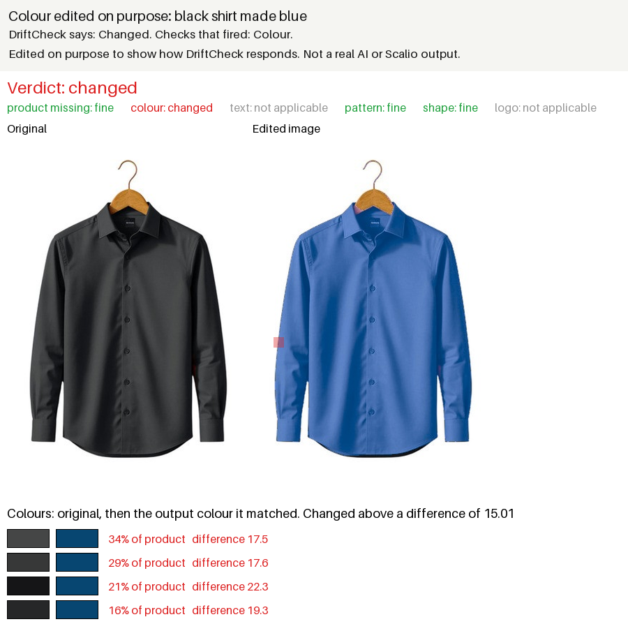
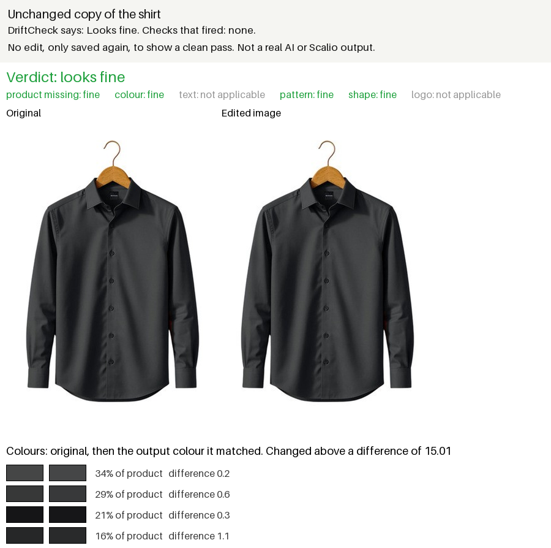
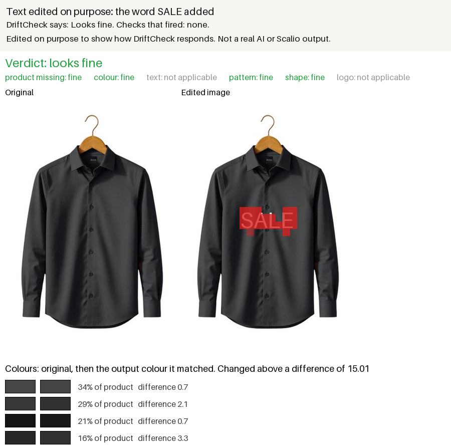
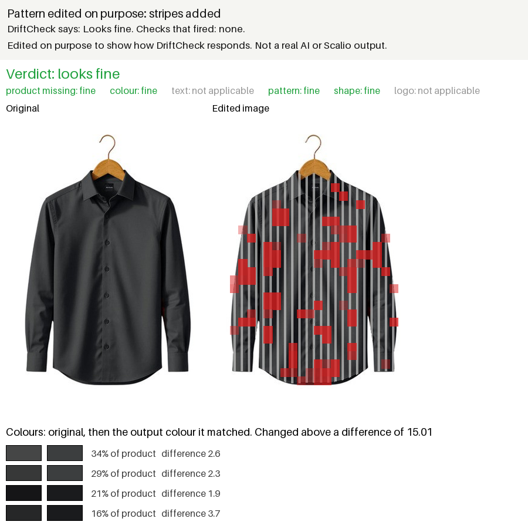

# DriftCheck

DriftCheck checks whether an AI generated product image changed the real product.

## See it work

These pairs use one photo of a shirt. The second image in each pair was edited on purpose to show how DriftCheck responds. They are not real AI outputs and not Scalio outputs. The results come from examples/results.json, made by running the full pipeline with qwen2.5vl:7b on local Ollama.

**The black shirt made blue.** DriftCheck says changed, and the colour check fired.



**An unchanged copy.** DriftCheck says it looks fine, and no check fired.



Two more edits of the same shirt, added text and added stripes, were missed. They are shown under Limitations, with the reason for each.

## Quickstart

You need Windows with Python 3.12, and **Ollama**, which runs the vision model on your own computer. Install the Ollama app from https://ollama.com, open it, then run this once to get the model:

```
ollama pull qwen2.5vl:7b
```

Then run these in PowerShell, in order:

```
git clone https://github.com/MohammedZaid-AI/driftcheck.git
cd driftcheck
py -3.12 -m venv .venv
.venv\Scripts\python -m pip install torch torchvision --index-url https://download.pytorch.org/whl/cpu
.venv\Scripts\python -m pip install -e ".[all]"
copy .env.example .env
.venv\Scripts\driftcheck demo
```

The last command opens the demo at http://localhost:7860. Click one of the four examples and press Run DriftCheck. The first run takes about a minute while the models load.

To check one pair from the command line instead:

```
.venv\Scripts\driftcheck check --original examples\plain_shirt_original.jpg --output examples\plain_shirt_colour.jpg --out reports\check --model qwen2.5vl:7b --image-type flat
```

To run the tests, which need no Ollama:

```
.venv\Scripts\python -m pytest
```

## What it is

You give DriftCheck the original product photo and an AI output. It tells you if the product itself changed, which part changed, and why it thinks so. It does not make images and it does not replace any image generator.

## The problem

Apps like Scalio turn a seller's product photo into model shots, studio shots, posters and Reels with AI. Public reviews of the Scalio app say the AI often changes the product. A sleeveless top comes back with sleeves. Embroidery and prints change. Logos and shop names come out wrong. Some reviewers say this kept happening after an update that promised products would stay exactly as they look in the photo.

The seller pays credits for each output, and Scalio's refund policy says credits spent on bad outputs are not returned. A drifted image costs the seller money and trust. If the seller does not notice, their customers see a product that is not what they will receive.

Sources:

1. Scalio on Google Play: https://play.google.com/store/apps/details?id=com.scalioai.app
2. Scalio on the App Store: https://apps.apple.com/in/app/scalio-ai-videos-photos/id6752993248
3. Scalio refund policy: https://scalio.app/legal/refund-policy/

## What DriftCheck does

DriftCheck is a test tool for a team that builds an image generator. Run it on a test set before a release and it says how often the generator changes products, and where. Run it on one image and it explains that one image.

It runs on a normal laptop. The vision model runs locally on Ollama. No paid API is needed.

## How it works

1. **Cut out the product.** rembg cuts the product out of both images. When a person wears the product, a local clothes parsing model keeps only the garment, so the face, arms and other clothes do not count as product.
2. **Read the original once.** A product card records the colours, the text and the shape of the original.
3. **Check that the product is there.** If the product is missing or tiny in the output, the image is flagged and the other checks are skipped.
4. **Run the five checks.**
    1. Colour compares the main colours of the two products.
    2. Text reads the words on both products with easyocr in English, Hindi, Kannada and Bengali, and matches them. When OCR misses a word, the vision model reads it as a backup.
    3. Pattern compares small patches of the print or texture with DINOv2 features.
    4. Shape asks the vision model to describe sleeves, neckline and length in both images and compares the answers.
    5. Logo asks the vision model whether the logo is still there.
5. **Route by image type.** A studio output is a flat image, so all five checks run. A model shot, lifestyle scene, poster or Instagram post is a scene image. On a scene image, colour and pattern are skipped, because the same product looks different on a body or in a scene. A skipped check is not a pass and not a fail. It is left out.
6. **Give a verdict.** If any check that ran says changed, the verdict is changed. If every check that ran says fine, the verdict is fine. Otherwise it is not sure.

## More commands

Set up as in the Quickstart first. Check one image:

```
.venv\Scripts\driftcheck check --original ORIGINAL.jpg --output OUTPUT.jpg --out reports\check --model qwen2.5vl:7b
```

This writes report.json and heatmap.png. Add `--image-type flat` or `--image-type scene` to set the image type. Without it, the type comes from the style in the output's file name.

Open the demo:

```
.venv\Scripts\driftcheck demo
```

It opens http://localhost:7860. The walkthrough is in docs\demo.md.

Build and evaluate a test set:

```
.venv\Scripts\driftcheck ingest
.venv\Scripts\driftcheck select
.venv\Scripts\driftcheck scripts
.venv\Scripts\driftcheck jobs
.venv\Scripts\driftcheck register
.venv\Scripts\driftcheck split
.venv\Scripts\driftcheck label
.venv\Scripts\driftcheck synth
.venv\Scripts\driftcheck eval-run
.venv\Scripts\driftcheck eval
```

`driftcheck --help` lists every command. Run the tests with `.venv\Scripts\python -m pytest`.

## Results

These numbers come from reports/eval_report.json. They were measured on this dataset only. They say nothing about how Scalio's own app performs.

**The data.** 40 products: clothing, packaged food, beauty, accessories and shop fronts. Two AI outputs per product were made by hand in the free Gemini app, model 3.6 Flash, so 80 real outputs in total. All 80 were labelled as unchanged by hand. Because the real outputs have no labelled changes, catches are measured on 326 synthetic copies of the originals. Most have the colour, text, pattern, sleeves or the whole product changed on purpose. The rest are left unchanged apart from light, compression or framing, to count wrong flags. Products are split in half. Thresholds were tuned on one half and the numbers below are on the other half: 40 real outputs and 159 synthetic copies, 99 of them changed.

**Main numbers on the test half.**

| | DriftCheck |
|---|---|
| Real Gemini images wrongly flagged | 11 of 40, 27.5% |
| Synthetic changes caught | 57 of 99, 57.6% |
| Unchanged synthetic copies wrongly flagged | 13 of 60, 21.7% |
| Precision on synthetic copies | 81.4% |

**Each check.** Wrong flags are on the real images. Catches are on the synthetic changes. Colour and pattern only run on flat images, so their wrong flags are counted on the 18 flat real images.

| Check | Real images wrongly flagged | Synthetic changes caught |
|---|---|---|
| Colour | 0 of 18, 0.0% | 6 of 18, 33.3% |
| Pattern | 0 of 18, 0.0% | 12 of 26, 46.2% |
| Text | 1 of 35, 2.9% | 18 of 32, 56.2% |
| Shape | 4 of 40, 10.0% | 1 of 11, 9.1% |
| Logo | 5 of 35, 14.3% | no synthetic logo changes, not measured |
| Product present | 1 of 40, 2.5% | 2 of 20, 10.0% |

**Baselines.** A whole image similarity score with one threshold caught 0 of 99 changes and flagged 0 of 40 real images: at the tuned threshold it never flags. One yes or no question to the vision model caught 5 of 99 changes and flagged 0 of 40 real images.

**Speed.** On a laptop with 12 GB of RAM and a 6 GB RTX 3050, one real output took a median of 51.5 seconds and 143.6 seconds for the slowest 10 percent, with 2.42 vision calls per image.

**How the numbers got here.** The first report flagged 27 of 40 real images and caught 80 of 99 synthetic changes. Four changes followed: a garment only cut out for worn clothing, retuning so that at most 10 percent of the real calibration images are flagged per check, routing checks by image type, and a fix so the evaluation decides text the same way the live check does. Each change and its numbers are in the table at the top of reports/eval_report.md.

**Honesty note.** All of the tuning and every one of those changes happened after the first test results were seen. The test half was not used to fit thresholds, but it did shape the decisions. Treat these numbers as a first measurement, not a final one.

## Limitations

1. **Text passes garbled words.** The tuned text threshold is a match score of 40. At that level, a brand name read back with two or three letters changed still counts as the same text. On its own, the text check caught none of the synthetic text replacements in the test half.
2. **New text is not checked.** The text check only confirms that text on the original is still there. Text the generator adds is never looked at. In the example below, the word SALE was added to the plain shirt on purpose. The original has no text, so the text check said not applicable and the verdict was looks fine. This is a miss.

    

3. **The pattern setting is loose.** The pattern check only flags when more than 90 percent of the product differs. This setting came from tuning on the real calibration images, where worn and scene photos made the check flag good images. In the example below, stripes were added to the plain shirt on purpose. The pattern check marked 22 percent of the shirt as different, shown in red, and passed it. This is a miss.

    

4. **The vision model is weak on shape.** The shape check caught 1 of 11 synthetic sleeve changes and wrongly flagged 4 of 40 good images. The logo check wrongly flagged 5 of 35.
5. **Colour and pattern only work on flat photos.** They are skipped on model shots, lifestyle scenes and posters, so a colour or print change in those images is only caught if another check notices it.
6. **New colours are not counted.** The colour check asks whether each original colour is still there. Colours the generator adds, like the grey stripes in the example under item 3, do not count.
7. **No real drift in the test set.** All 80 real outputs were labelled unchanged, so catches come only from synthetic changes, which are cleaner than real AI drift.
8. **One generator.** All real outputs come from the Gemini app. The Kaggle route with Qwen Image Edit ran out of GPU memory on free Kaggle GPUs.
9. **Small data.** 40 products and 80 real outputs.
10. **Slow on a laptop.** A median of 51.5 seconds per real output with qwen2.5vl:7b. With the 7b model loaded, easyocr sometimes crashed the process during the evaluation. The evaluation restarts itself after a crash.
11. **Some text is hard to read.** A large Bengali title was misread, and the script on some products had to be set by hand because OCR guessed it wrong.

docs\limitations.md has the full list.

## Next steps

1. **Strict text compare.** When OCR reads a word clearly in both images, compare it strictly instead of with the loose threshold, so a changed letter fails. Keep the loose match only when OCR is unsure.
2. **Check for added text.** Flag clear text in the output that was not on the original.
3. **A tighter pattern rule for flat photos.** Now that scene photos skip the pattern check, retune its setting on flat images only, where the same garment should match closely.
4. **Check for added colours.** Also ask whether a large share of the output has colours that were not on the original.
5. **A stronger shape check.** Try a larger vision model, or measure sleeve and length from the garment cut out directly.
6. **Colour and pattern for scene images.** Compare only matching garment regions instead of skipping these checks.
7. **Real drift labels.** Label real outputs that did change, so catches are measured on real AI drift.
8. **More generators.** Run the same products through other image generators and compare them.
9. **Video frames.** Run the checks on frames from generated Reels.
10. **Block bad outputs before users pay.** Run DriftCheck before an output is shown, so the seller is not charged credits for a changed product.

## Project files

1. PROGRESS.md: what was done, in order, with every decision.
2. reports\eval_report.md: the full evaluation report.
3. docs\limitations.md: where it fails.
4. docs\demo.md: how to show the demo.
5. docs\make_outputs.md: how the AI outputs were made.
6. examples\: the public example pairs. scripts\make_examples.py makes the edits from data\samples\plain_shirt.jpg, and scripts\make_figures.py runs DriftCheck on them and draws docs\images.
